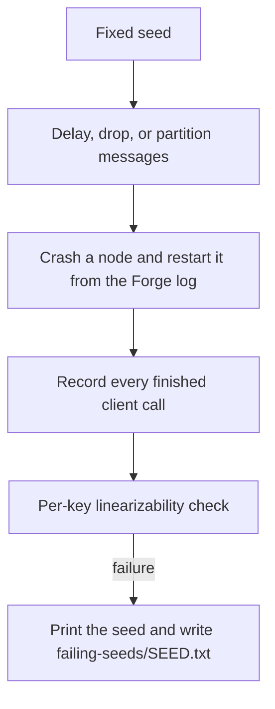

# Quorum

Quorum runs Raft on three nodes. The log and the hard state (current term, vote, and log end) are keys in a [Forge](https://github.com/psp5288/forge) store. Forge's `durable_commit` fsyncs the WAL before it returns. A follower replies to AppendEntries only after that fsync. The leader acknowledges a client write only after a majority of nodes have the entry.

Client reads and writes go to the leader. A follower answers with HTTP 307 and `X-Quorum-Leader`.

Guarantee: linearizable writes.

A read is served by the leader only after it has committed an entry from its current term and a majority has answered a heartbeat in that term. A partitioned leader does not answer the read.

`forge-core` is pinned to `12a028319818fd6ffe4c516bccb7ded9a84b74de`.




## Run

```sh
cargo test
cargo run --release --bin quorum -- bench
docker compose up --build
```

`docker compose up --build` is the one-command local cluster. Host ports are 8001, 8002, and 8003. Raft uses the Docker network names `n1`, `n2`, and `n3`. One start of that command on this machine brought the three processes up: node 2 was leader, `PUT /kv/docker-key` on port 8002 returned 200, `GET` on that port returned `docker-value`, and port 8001 answered the same PUT with 307 and `X-Quorum-Leader: http://127.0.0.1:8002`. That check is not a benchmark.

Each process logs one JSON object per line on stderr. `GET /metrics` returns:

```
quorum_node
quorum_role
quorum_term
quorum_commit
quorum_applied
quorum_leader
quorum_log_end
quorum_fsync_total
```

`quorum_role` is 1 follower, 2 candidate, 3 leader.

`PUT /kv/{key}` and `GET /kv/{key}` are the client API. `GET /health` is served by every node.

## What was run

`cargo test` on this machine: 12 library tests passed, 1 three-process cluster test passed, 0 failed. The library run includes the checker, a fault-free simulation, and fault seeds 1 through 24. The cluster test writes a key, reads it from the leader, and checks that another node returns 307.

The fault simulator prints the seed and writes `failing-seeds/{seed}.txt` when a run fails. Those 24 seeds passed, so no seed file was kept.

## Benchmark

`cargo run --release --bin quorum -- bench`, two runs, on commit `0bb6521106b004edac3efa80e4001ae0325ac8e3`.

Machine: Apple M5, Darwin 27.0.0 arm64, 17179869184 bytes of memory, APFS on an Apple Fabric SSD. The bench directories were under `/var/folders` on `/dev/disk3s5` (`/System/Volumes/Data`). `rustc 1.100.0 (0ef1bc386 2026-11-09)`.

Three local processes. Four clients. 32-byte values. A new TCP connection for each request. 16 warmup writes, not included in the rates below. Fsync-before-ack, as above.

| | run 1 | run 2 |
| --- | --- | --- |
| writes | 100 in 1.050 s, 95.23 ops/sec, p50 42.748 ms, p99 50.420 ms | 100 in 1.051 s, 95.18 ops/sec, p50 42.313 ms, p99 48.716 ms |
| reads | 100 in 0.080 s, 1250.93 ops/sec, p50 3.154 ms, p99 4.768 ms | 100 in 0.079 s, 1272.45 ops/sec, p50 3.150 ms, p99 4.217 ms |
| `quorum_fsync_total` sum, three nodes, across those 100 writes and 100 reads | 55 to 355, delta 300 | 55 to 355, delta 300 |
| failover, SIGKILL of the leader until a later write was acknowledged | 257.289 ms, 13 attempts, that write 7.764 ms, node 3 killed | 297.606 ms, 16 attempts, that write 11.190 ms, node 3 killed |
| restarted process printed `quorum ready` | 2.761 ms | 6.768 ms |
| restarted process reached leader commit 139 | 221.313 ms from process start, 9 writes acknowledged in that window | 103.501 ms from process start, 1 write acknowledged in that window |

Election timeouts in the code are 150 ms to 300 ms. The failover samples sit in that range. The recovery windows held 9 writes and 1 write, so this file does not cite a recovery throughput.

## Conclusion

On commit `0bb6521106b004edac3efa80e4001ae0325ac8e3`:

The linearizability checker passed the fault-free seed and fault seeds 1 through 24. No failing seed was kept.

Failover, from SIGKILL of the leader until a write was acknowledged, was 257.289 ms and 297.606 ms on the two release runs.

During the 100 measured writes and 100 measured reads, with all three processes still up, the sum of `quorum_fsync_total` rose by 300 on both runs. Sustained write throughput was 95.23 ops/sec for 1.050 s and 95.18 ops/sec for 1.051 s. Read throughput was 1250.93 ops/sec for 0.080 s and 1272.45 ops/sec for 0.079 s. The restarted node's commit index caught the pre-restart leader commit in 221.313 ms and 103.501 ms.

The simulator did not fail a seed, so no bug from the simulator is claimed.
